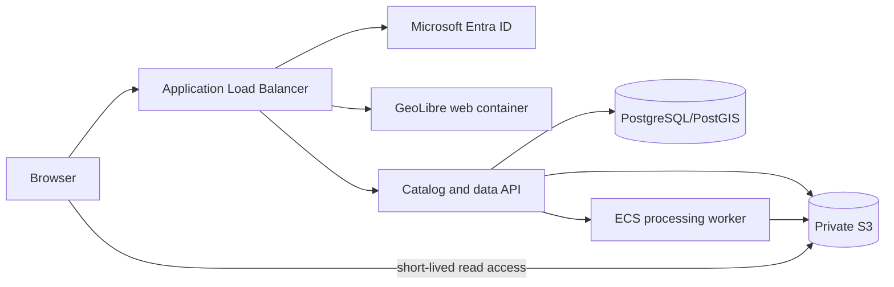
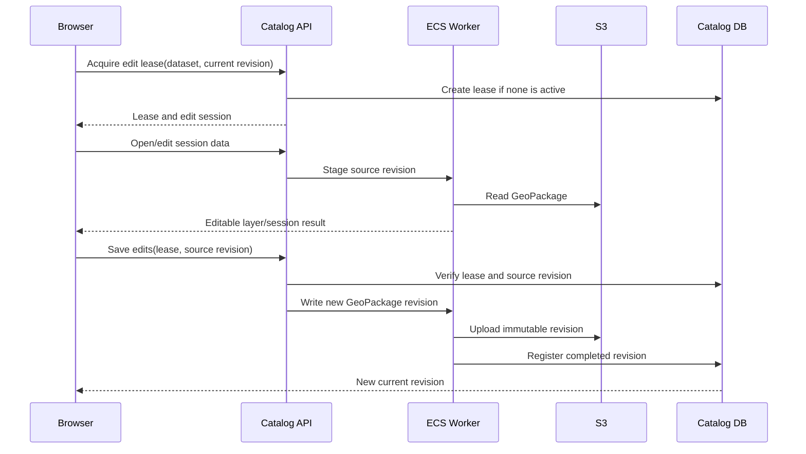

# Private S3 + Entra MVP

**Status:** architecture proposal and implementation plan

**Implementation status:** deployed and verified end to end on the disposable
`us-east-1` stack. Entra-federated browser access is live: the user signs in
with their company account (PKCE popup through the shared OAuth callback),
exchanges the ID token with AWS STS directly from the browser (STS CORS
verified), and the resulting temporary credentials drive the stock S3 Browser
plugin — no credential backend and no user-entered keys. The S3 Browser now
prefills and auto-opens the deployment's configured bucket, falls back to
connection-named buckets when `s3:ListAllMyBuckets` is refused, and shows
clickable breadcrumbs. Also implemented: catalog API and upload/revision
contracts, a GeoTIFF job worker (`raster.clip`/`reproject`/`cog`), and
lease-bound GeoPackage revision uploads. Remaining: save-back (PUT signing +
editor/project "Save to S3"), full GeoPackage editing UI, durable job queue,
and replacing the Basic Auth site gate with Entra.

This document defines the MVP for deploying GeoLibre as an internal AWS web GIS
for authorized company users who browse, view, edit, and create derived outputs
from private S3 data.

It is deliberately narrower than a general-purpose cloud GIS. The MVP keeps
GeoLibre's existing browser/map experience and adds a catalog, authenticated
S3 access, server-side file workflows, revisioning, and controlled editing.

## Decision summary

Use the existing GeoLibre web application as the UI and map engine. Deploy it
on ECS/Fargate behind an Application Load Balancer (ALB) configured for
Microsoft Entra OIDC. Add a same-origin catalog and data service backed by
PostgreSQL/PostGIS and a private S3 bucket. Use server-side workers for
GeoPackage editing and GeoTIFF-derived outputs.

Do **not** use `s3fs`/FUSE. Do **not** make a plugin the authorization boundary.
Do **not** treat raw S3 prefixes as the primary user interface.

The existing S3 Browser and signer remain useful for the read path:

- `packages/core/src/s3.ts` owns S3 URL parsing, SigV4 signing, and the signer
  contract.
- `apps/geolibre-desktop/src/lib/s3-signer.ts` is the web/desktop signer
  implementation and should gain a managed deployment credential provider.
- `packages/plugins/src/plugins/maplibre-s3-browser.ts` is the existing browse
  and add-to-map UI. It should consume catalog results instead of becoming the
  security layer.

## Confirmed requirements

### Users and deployment

- Web deployment on AWS ECS/Fargate.
- ALB in front of the application.
- Authentication through one company Microsoft Entra tenant.
- Only authorized Entra users may use the deployment.
- All authorized users initially share the same approved data scope.
- The S3 bucket remains private.
- Users do not manually download files to disk and upload them again.
- Users may work with files under approved logical folders/prefixes.

### Data and scale

- Catalog-first dataset discovery rather than raw S3 navigation.
- S3 paths remain optional storage details.
- Hundreds of thousands of objects are possible.
- Individual files may be 1–10 GB.
- Search must not recursively scan S3 for every user query.
- Initial formats are GeoPackage and GeoTIFF/COG.

### GeoPackage behavior

- Open a GeoPackage from S3.
- Edit features and attributes.
- Only one user edits a dataset at a time.
- Every save creates a new revision.
- The original remains recoverable.
- Conflicting edits are rejected rather than merged.

### GeoTIFF behavior

- View GeoTIFF/COG data from S3.
- Run selected processing operations.
- Save derived outputs as new S3 revisions.
- Interactive pixel editing is out of scope for the MVP.

### Upload behavior

- Users can select an approved destination folder.
- New uploads use server-generated keys.
- Initial upload behavior is create-only.
- Arbitrary overwrite and delete are out of scope.

## Non-goals

The MVP does not include:

- Interactive GeoTIFF pixel painting.
- Generic in-place writes to arbitrary S3 keys.
- Simultaneous edit merging.
- Raw S3 bucket browsing as the primary discovery workflow.
- Server-side support for every GeoLibre processing tool.
- A general S3 filesystem mount.
- User-managed AWS access keys.
- Per-user dataset permissions in the first release.
- Delete, rename, or destructive replacement workflows.
- A new standalone GIS application.

## Proposed architecture



### Request paths

| Operation | Request path | Authorization owner | Storage behavior |
| --- | --- | --- | --- |
| Sign in | Browser → ALB → Entra | ALB/Entra | Session cookie |
| Search datasets | Browser → catalog API | Catalog API | PostgreSQL/PostGIS query |
| Browse logical folders | Browser → catalog API | Catalog API | Catalog records, optionally backed by S3 prefixes |
| View GeoTIFF/COG | Browser → S3 using short-lived access | S3 IAM policy plus catalog-issued scope | HTTP range reads |
| Open GeoPackage for edit | Browser → edit API → worker → S3 | Catalog API and edit lease | Worker stages object |
| Save GeoPackage | Browser → edit API → worker → S3 | Catalog API and revision check | New immutable revision |
| Create GeoTIFF output | Browser → job API → worker → S3 | Catalog API | New derived object/revision |
| Upload new file | Browser → upload API → presigned S3 upload | Catalog API | Server-generated key |

The browser must never be trusted to enforce folder or object authorization.
The API validates dataset IDs, folder IDs, revision IDs, and edit leases before
issuing access or starting a job.

## Identity and authentication

### ALB OIDC

Configure the ALB listener with an OIDC authentication action for the company
Entra tenant. Store the Entra client secret in AWS Secrets Manager or the
approved AWS secret-management system.

Protect these routes:

- GeoLibre application routes.
- Catalog and search API.
- Upload and edit-session API.
- Processing-job API.

Keep the target service private so users cannot bypass the ALB and inject fake
identity headers. The API must validate the ALB identity context according to
the selected ALB integration pattern; it must not trust arbitrary
`X-User`/`X-Email` headers from the public network.

The existing Clerk/Auth0 gates are not needed for this deployment. They are UI
gates, not general API authorization boundaries.

### Authorization model

The first release has one approved data scope for all authorized users. The
service still models authorization explicitly so Entra groups or app roles can
be mapped to dataset scopes later.

Recommended future-ready policy shape:

```text
principal: Entra object ID or app role
scope: catalog folder / dataset collection
permissions: read, edit, create, process
```

Do not put long-lived AWS keys in browser settings, environment variables
published to the frontend, or project files.

## Catalog model

The catalog is the user-facing source of truth. S3 is the object store, not the
user-facing information architecture.

### Suggested entities

```text
folder
  id
  parent_id
  display_name
  logical_path
  storage_prefix
  allowed_operations
  created_at

 dataset
  id
  folder_id
  display_name
  format
  description
  bbox
  temporal_extent
  current_revision_id
  created_at
  updated_at

 revision
  id
  dataset_id
  s3_bucket
  s3_key
  s3_version_id
  etag
  size_bytes
  created_by
  created_at
  source_revision_id
  status

 edit_lease
  dataset_id
  principal_id
  revision_id
  expires_at
  heartbeat_at

 processing_job
  id
  dataset_id
  input_revision_id
  operation
  parameters
  output_revision_id
  status
  error
  created_by
  created_at
  completed_at
```

The exact schema may differ if an existing catalog is adopted, but these
invariants are required:

- A dataset has one current revision.
- A revision is immutable after completion.
- A revision points to exactly one S3 object version/key.
- A save never silently changes another revision.
- A lease has an owner and expiration.
- Failed jobs do not become current revisions.

### Search

Search should query catalog metadata, not S3 directly. The initial index should
support:

- Dataset name and filename.
- Folder.
- Format.
- Modified/created date.
- Size.
- Bounding box, if available.
- Time extent, if available.
- Processing status.

Existing objects require an inventory/backfill job. New uploads and derived
outputs should register catalog records as part of their completion workflow.
S3 Inventory, object events, or a scheduled reconciliation job can keep the
catalog synchronized.

## S3 access design

### Read path

For direct GeoTIFF/COG viewing, use short-lived access issued by the managed
deployment service. The existing `S3UrlSigner` abstraction is the integration
point. Credentials or signed URLs must be held only for their useful lifetime;
they must not be persisted in `DesktopSettings` or project files.

The read role should be restricted to approved resources:

```text
s3:ListBucket
  bucket: company-data
  only approved catalog prefixes

s3:GetObject
  company-data/approved/*
```

Avoid `s3:ListAllMyBuckets` unless account-wide bucket discovery is explicitly
required. Catalog search should normally replace the current S3 Browser's
account-wide bucket listing.

Configure S3 CORS for the deployed origin and the headers needed by range
readers, including `Content-Range`, `Content-Length`, `ETag`, and
`Accept-Ranges`.

### Upload path

The API accepts a catalog folder ID and file metadata, not a raw S3 key:

```http
POST /api/uploads
Content-Type: application/json

{
  "folderId": "imagery-2026",
  "filename": "scene.tif",
  "contentType": "image/tiff",
  "sizeBytes": 184392001
}
```

The service validates the folder and generates the key, for example:

```text
incoming/imagery/2026/8d3c.../scene.tif
```

It returns a short-lived presigned POST/PUT with size and content constraints.
The browser uploads directly to S3. Completion is reported to the API, which
validates the object and creates the catalog record.

The initial upload role has no delete permission and cannot overwrite an
existing generated key.

### Versioning

Use immutable revision keys and enable S3 versioning as a recovery mechanism.
A revision key may look like:

```text
datasets/<dataset-id>/revisions/<revision-id>/data.gpkg
```

The catalog's `current_revision_id` points to the revision shown by default.
This is preferable to relying only on an S3 VersionId because it makes revision
search, audit, rollback, and processing outputs explicit to the application.

## GeoPackage editing workflow

GeoPackage is a SQLite container. Direct random writes against S3 are not a
safe editing model. The worker must stage the file locally before editing.



The exact session strategy is an implementation choice. The MVP must enforce:

- One active editor per dataset.
- Lease expiry and recovery.
- Source revision captured at lease creation.
- New revision on save.
- Original revision preserved.
- Failed saves leave the current revision unchanged.

The existing local write path is in
`packages/processing/src/sidecar-client.ts`. It expects a filesystem path and
must not receive an arbitrary S3 URL as if it were local storage.

## GeoTIFF and COG workflow

GeoTIFF/COG viewing remains a direct browser read path using HTTP range
requests. Derived outputs use jobs:

```text
input revision
  → validate operation and parameters
  → worker stages or streams source
  → raster operation runs
  → output GeoTIFF/COG is validated
  → immutable output revision is uploaded
  → catalog points to output
```

The MVP must select a finite operation set. A conservative initial set is:

- Clip by extent.
- Reproject.
- Resample.
- Convert to COG.
- One or two agreed raster analysis operations.

Do not claim generic GeoTIFF editing until the output format, nodata handling,
CRS behavior, compression, tiling, and validation rules are defined.

## Folder and dataset UX

The primary interface should be:

1. Search catalog.
2. Filter by format, folder, date, or extent.
3. Open a dataset record.
4. View or add the current revision to the map.
5. Start an edit or processing job where permitted.
6. Save a new revision into the dataset history.

S3 prefixes may appear as a storage path for diagnostics, but users should not
need to understand the raw key layout.

The existing S3 Browser may remain available as an administrator or fallback
view, but it should not be the only discovery workflow. It currently uses
`ListObjectsV2` with a `/` delimiter and paginates 200 entries at a time:
`packages/plugins/src/plugins/s3-browser-api.ts`.

## Alternatives assessment

### Existing GeoLibre

Recommended MVP base.

Strengths:

- Existing browser application and Docker image.
- Existing S3 parser, signer, readers, and S3 Browser.
- Existing map editing and processing surfaces.
- Existing FastAPI sidecar and deployment policy.
- Existing catalog integration point through the GeoLens plugin.

Required additions:

- Entra/ALB deployment contract.
- Catalog API and metadata model.
- Managed S3 read credentials.
- Remote GeoPackage staging/write-back.
- GeoTIFF job API and worker.
- Revision and lease UI.

### `geolibre-rust`

Useful as a processing dependency, particularly for browser or WASI GeoTIFF/
COG operations. It is not a complete application or multi-user data service; it
does not replace the catalog, Entra, S3 policy, revision, or edit-lease work.

### `RustGIS`

Potentially useful if the primary goal becomes a full GIS editor with broad
GeoPackage support. Its web deployment is documented as local/private and its
web Save/Export behavior is file-download oriented. It does not remove the
need for the private S3 catalog, Entra integration, server-side revisioning,
and large-file job infrastructure.

Switching to RustGIS for the MVP is not recommended unless a proof of concept
shows that its web editor can consume the required catalog records and save
versioned GeoPackages through the proposed API without a major integration
rewrite.

## Detailed implementation plan

### Phase 0 — Architecture and acceptance lock

- [ ] Confirm the initial approved S3 bucket(s) and root prefixes.
- [ ] Confirm AWS region(s) and deployment hostname.
- [ ] Define the Entra app registration and allowed users/groups/app roles.
- [ ] Select the catalog implementation: existing GeoLens integration or a
      dedicated PostgreSQL/PostGIS service.
- [ ] Select the initial GeoTIFF operation set.
- [ ] Define maximum GeoPackage size and maximum concurrent jobs.
- [ ] Define revision retention and cleanup policy.
- [ ] Define audit-log retention.
- [ ] Define the upload content-type and size allowlist.
- [ ] Write the final MVP acceptance scenarios before implementation.

**Exit criteria:** The team can name every protected route, approved S3
prefix, supported file operation, revision transition, and failure behavior.

### Phase 1 — AWS foundation and identity

- [ ] Create ECS/Fargate service for the GeoLibre web container.
- [ ] Create ALB HTTPS listener and target group.
- [ ] Configure Entra OIDC authentication action.
- [ ] Store OIDC client secret in Secrets Manager.
- [ ] Configure health checks outside the authenticated route.
- [ ] Ensure ECS tasks are not publicly reachable except through the ALB.
- [ ] Configure CloudWatch logs, metrics, and alarms.
- [ ] Remove or disable Basic Auth for the multi-user deployment.
- [ ] Disable public project sharing unless explicitly required.
- [ ] Restrict external plugin loading with deployment policy.
- [ ] Remove production CSP allowances for visitor loopback probing.

**Acceptance criteria:** An unauthorized user is redirected to Entra and cannot
reach the application or API. An authorized user can reach the application.
Direct access to the ECS task does not bypass authentication.

### Phase 2 — Catalog foundation

- [ ] Define catalog schema and migrations.
- [ ] Implement folders and dataset records.
- [ ] Implement immutable revisions and current-revision pointers.
- [ ] Implement catalog search with pagination.
- [ ] Implement filters for name, folder, format, date, and extent where
      metadata exists.
- [ ] Implement S3 inventory/backfill import for existing objects.
- [ ] Implement reconciliation for missing or changed S3 objects.
- [ ] Implement dataset detail and revision history endpoints.
- [ ] Implement audit records for reads of protected operations, edits, uploads,
      jobs, and failures.

**Acceptance criteria:** A user can find a dataset without knowing its S3 key,
open its metadata, see its current revision, and browse its revision history.
Search performance does not depend on recursively listing the bucket.

### Phase 3 — Managed S3 read access

- [ ] Create a dedicated IAM read role.
- [ ] Restrict `ListBucket` to approved prefixes.
- [ ] Restrict `GetObject` to approved data prefixes.
- [ ] Decide between short-lived temporary credentials and broker-issued signed
      URLs for the read path.
- [ ] Add a managed deployment credential provider to the existing S3 signer.
- [ ] Keep credentials in memory only.
- [ ] Refresh credentials before expiration.
- [ ] Preserve unsigned `s3://` source URLs in layers and projects.
- [ ] Configure exact-origin S3 CORS for GET/range reads.
- [ ] Add integration tests for private COG and GeoPackage reads.

**Acceptance criteria:** An authorized user can view a private GeoTIFF/COG and
open a catalog-selected GeoPackage. An expired read credential refreshes. An
unauthorized bucket/key cannot be read through the managed provider.

### Phase 4 — Catalog-first GeoLibre UI

- [ ] Add a catalog data source/panel to the web application.
- [ ] Add catalog search, filtering, pagination, and folder navigation.
- [ ] Add dataset detail and revision history views.
- [ ] Add `Open` and `Add to map` actions.
- [ ] Replace raw S3 Browser-first discovery for the managed deployment.
- [ ] Keep the existing S3 Browser as an optional administrative/fallback tool.
- [ ] Add UI states for unavailable, processing, failed, and superseded
      revisions.
- [ ] Gate edit, upload, and processing controls through server responses, not
      only client capabilities.
- [ ] Add localized strings and RTL-safe layout rules.

**Acceptance criteria:** A user can locate a dataset by catalog metadata, add
its current revision to the map, and understand whether it is readable,
editable, processing, or unavailable.

### Phase 5 — GeoPackage edit sessions

- [ ] Add edit-lease table and API.
- [ ] Add lease acquisition, heartbeat, expiry, and release.
- [ ] Validate the source revision when acquiring a lease.
- [ ] Stage GeoPackage objects to controlled worker storage.
- [ ] Reuse or adapt the existing GeoPackage writer.
- [ ] Validate geometry, CRS, layer name, and feature counts before publication.
- [ ] Write a new immutable revision object.
- [ ] Register the revision transactionally with the catalog.
- [ ] Keep the old revision current if staging, writing, validation, or upload
      fails.
- [ ] Add conflict and expired-lease UX.
- [ ] Add a revision history and “open previous revision” action.

**Acceptance criteria:** One user can edit and save a GeoPackage without a
manual file transfer. A second user cannot edit the same dataset concurrently.
A failed or conflicting save never changes the current revision.

### Phase 6 — Uploads and folder destinations

- [ ] Add upload request API accepting a catalog folder ID, not an S3 key.
- [ ] Validate file name, content type, size, and supported format.
- [ ] Generate server-controlled object keys.
- [ ] Return short-lived presigned POST/PUT constraints.
- [ ] Verify object existence, size, checksum, and format after upload.
- [ ] Create the dataset and initial revision record.
- [ ] Add upload progress and retry UX.
- [ ] Prevent overwrite and delete in the MVP.
- [ ] Add upload audit records.

**Acceptance criteria:** A user can upload an approved file to a selected
catalog folder. The file appears in search after validation. The user cannot
choose an arbitrary bucket/key or overwrite an existing dataset.

### Phase 7 — GeoTIFF-derived outputs

- [ ] Implement job submission and status APIs.
- [ ] Create a worker queue and bounded concurrency.
- [ ] Define the first supported raster operations.
- [ ] Stage or stream input from S3.
- [ ] Generate validated GeoTIFF/COG output.
- [ ] Preserve CRS, nodata, band metadata, and expected dimensions.
- [ ] Upload output as an immutable revision.
- [ ] Register output metadata and lineage.
- [ ] Add progress, cancellation, retry, and failure reporting.
- [ ] Add cleanup for abandoned scratch files and failed outputs.

**Acceptance criteria:** A user can submit an approved raster operation and add
the resulting GeoTIFF/COG to the map without downloading or manually uploading
files. Invalid outputs never become current catalog revisions.

### Phase 8 — Security, scale, and operations

- [ ] Enable S3 Block Public Access.
- [ ] Enable S3 versioning and lifecycle rules.
- [ ] Encrypt objects with the approved KMS configuration.
- [ ] Add least-privilege IAM policy tests.
- [ ] Add request correlation IDs across browser, API, worker, and S3 actions.
- [ ] Add CloudWatch alarms for failed jobs, denied access, and queue depth.
- [ ] Load-test catalog search with hundreds of thousands of records.
- [ ] Load-test staging and processing for the maximum supported file size.
- [ ] Test task restart during an edit and during a processing job.
- [ ] Test expired leases and abandoned uploads.
- [ ] Test unauthorized access to catalog records, S3 objects, and API routes.
- [ ] Review plugin policy and disable untrusted plugins for the deployment.
- [ ] Run the repository frontend, backend, Docker, and E2E checks for changed
      paths.

**Acceptance criteria:** The deployment has documented recovery behavior,
observability, least-privilege access, and tested limits for the agreed file
sizes and object counts.

## API outline

The exact framework is open, but the contract should have stable semantics.

```text
GET    /api/me
GET    /api/folders
GET    /api/datasets?q=&folder=&format=&bbox=&page=
GET    /api/datasets/{dataset_id}
GET    /api/datasets/{dataset_id}/revisions
POST   /api/datasets/{dataset_id}/edit-lease
POST   /api/datasets/{dataset_id}/edit-lease/heartbeat
DELETE /api/datasets/{dataset_id}/edit-lease
POST   /api/datasets/{dataset_id}/edit-session
POST   /api/datasets/{dataset_id}/revisions
POST   /api/uploads
POST   /api/uploads/{upload_id}/complete
POST   /api/jobs
GET    /api/jobs/{job_id}
POST   /api/jobs/{job_id}/cancel
```

The API should return stable dataset and revision IDs. The frontend should not
make authorization decisions from raw S3 paths or user-editable strings.

## Testing plan

### Unit tests

- Catalog path and folder validation.
- S3 key generation.
- Filename and content-type validation.
- Revision state transitions.
- Lease acquisition, expiry, heartbeat, and release.
- Conditional save behavior.
- IAM scope calculation.
- Catalog search filters and pagination.

### Integration tests

- Entra/ALB-authenticated API request.
- Unauthorized request rejection.
- Private S3 range read.
- Presigned upload completion.
- GeoPackage stage/edit/write/register flow.
- GeoTIFF job success and failure.
- Worker restart and retry.
- S3 object missing or changed during a job.

### End-to-end scenarios

1. Unauthorized visitor is redirected to Entra.
2. Authorized user searches for a GeoTIFF and views it.
3. Authorized user searches for a GeoPackage and adds it to the map.
4. User acquires a GeoPackage edit lease and edits attributes/geometries.
5. User saves a new revision and opens that revision on the map.
6. A second user is refused an active edit lease.
7. A failed save leaves the previous revision current.
8. User uploads a new file into a selected catalog folder.
9. User runs an approved GeoTIFF operation and adds its output.
10. An expired credential, lease, upload, or worker job produces a recoverable
    UI error.

## Remaining decisions before implementation

These do not change the overall architecture, but they must be fixed before
Phase 0 exits:

1. The exact initial GeoTIFF operation list.
2. The catalog choice: GeoLens integration versus a dedicated catalog service.
3. Maximum supported GeoPackage and GeoTIFF sizes.
4. S3 revision retention and lifecycle duration.
5. Audit-log retention and required compliance fields.
6. Whether the initial deployment uses temporary AWS credentials or broker-issued
   signed URLs for browser reads.
7. Whether upload files create new datasets or may attach as revisions to an
   existing dataset.

Recommended defaults are: GeoLens only if it supports the required revision
and lease semantics; otherwise PostgreSQL/PostGIS; immutable revisions retained
for 90 days; create-only uploads create new datasets; and temporary read
credentials for direct range reads.
